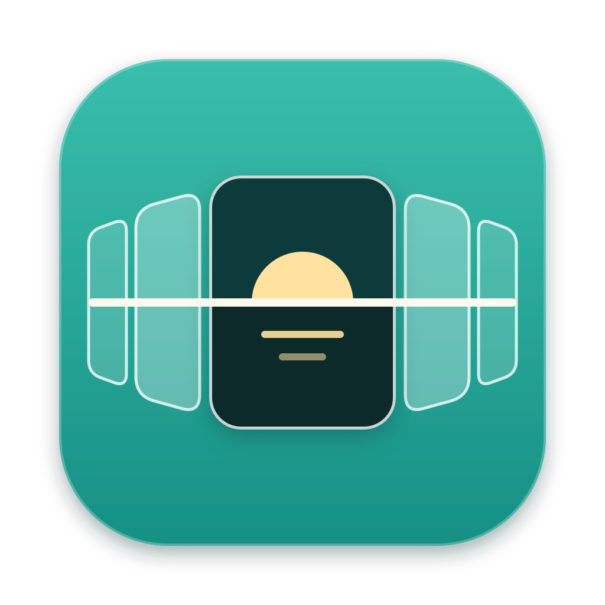
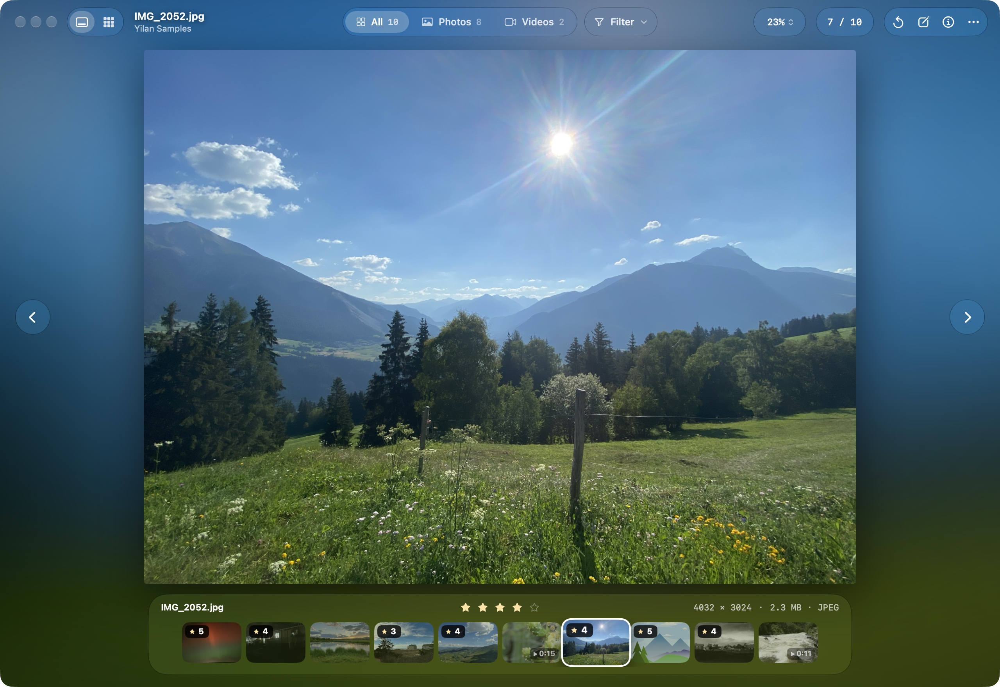
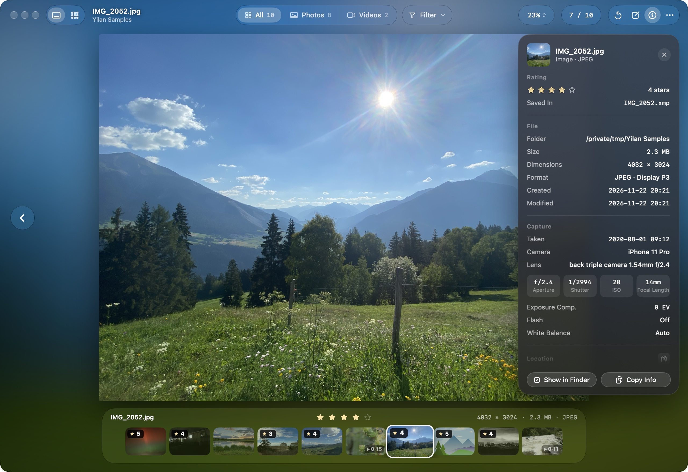
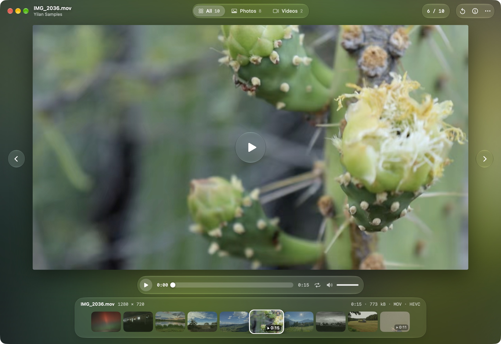

# Yilan 一览

[简体中文](README.zh-CN.md) | **English**

<p align="center"></p>

**Yilan (一览)** is a small image and video viewer for macOS. Open one file and browse the whole folder from a thumbnail strip at the bottom. Arrow keys switch instantly, and camera RAW files open fast.

## Preview

<p align="center"></p>

<table>
  <tr>
    <td></td>
    <td></td>
  </tr>
</table>

## Features

- Open one image or video and the app lists every supported file in that folder, in natural filename order
- Switch between All / Images only / Videos only, with counts
- Floating thumbnail strip that stays smooth with thousands of files; thumbnails are generated in the background and cached
- Neighbouring files are preloaded; switch with arrow keys, scroll wheel, on-screen arrows or by clicking a thumbnail
- JPEG, PNG, WebP, HEIC/HEIF, GIF (animated), SVG, TIFF, BMP and camera RAW from many brands (the embedded preview shows first, the full decode replaces it in the background)
- MP4, M4V and MOV playback (including iPhone HEVC video) with a floating control bar
- Zoom, pan, double-click to toggle fit-to-window and actual size, rotate
- New in v0.2: info panel (press I: file info and EXIF), move to Trash with ⌘Z undo, full screen (press F), live folder sync (new files are highlighted), and a keyboard shortcuts page in Settings
- UI languages: Simplified Chinese and English

## Requirements

- macOS 26 (Tahoe) or later
- Apple silicon and Intel Macs (the release build is a universal binary)

## Download and install

1. Download the latest `Yilan-<version>.zip` from [GitHub Releases](https://github.com/paddychenc75/yilan/releases), unzip it and drag `Yilan.app` into your Applications folder.
2. The app is only ad-hoc signed. It is not signed with an Apple Developer ID and not notarized, so the first time you open it macOS will say it cannot verify the developer. There are two ways around that; use either one:
   - **GUI:** double-click the app once (it will be blocked), then open System Settings › Privacy & Security, scroll down to the message about Yilan and click "Open Anyway".
   - **Command line:** run
     ```sh
     xattr -dr com.apple.quarantine /Applications/Yilan.app
     ```
3. After that it opens normally.

You can compare `shasum -a 256 Yilan-<version>.zip` with the checksum on the Release page.

## Build from source

You need Xcode with the macOS 26 SDK and [XcodeGen](https://github.com/yonaskolb/XcodeGen) (`brew install xcodegen`).

```sh
cd app
xcodegen generate
xcodebuild -project Yilan.xcodeproj -scheme Yilan -configuration Release \
  -derivedDataPath build/release build
```

Run the tests:

```sh
xcodebuild -project Yilan.xcodeproj -scheme Yilan -destination 'platform=macOS' test
```

Build the release package (Release build, ad-hoc signing, zip, SHA-256; output goes to `dist/`):

```sh
scripts/release.sh
```

## Test media and image credits

- The test samples in `app/Fixtures/` are all CC0 or public domain; sources are listed in [app/Fixtures/CREDITS.md](app/Fixtures/CREDITS.md). The camera RAW samples are too large for the repo; their download links are in the same file.

## License

[MIT](LICENSE), Copyright (c) 2026 PaddyChen. Media files keep the licenses listed in the credits above.
