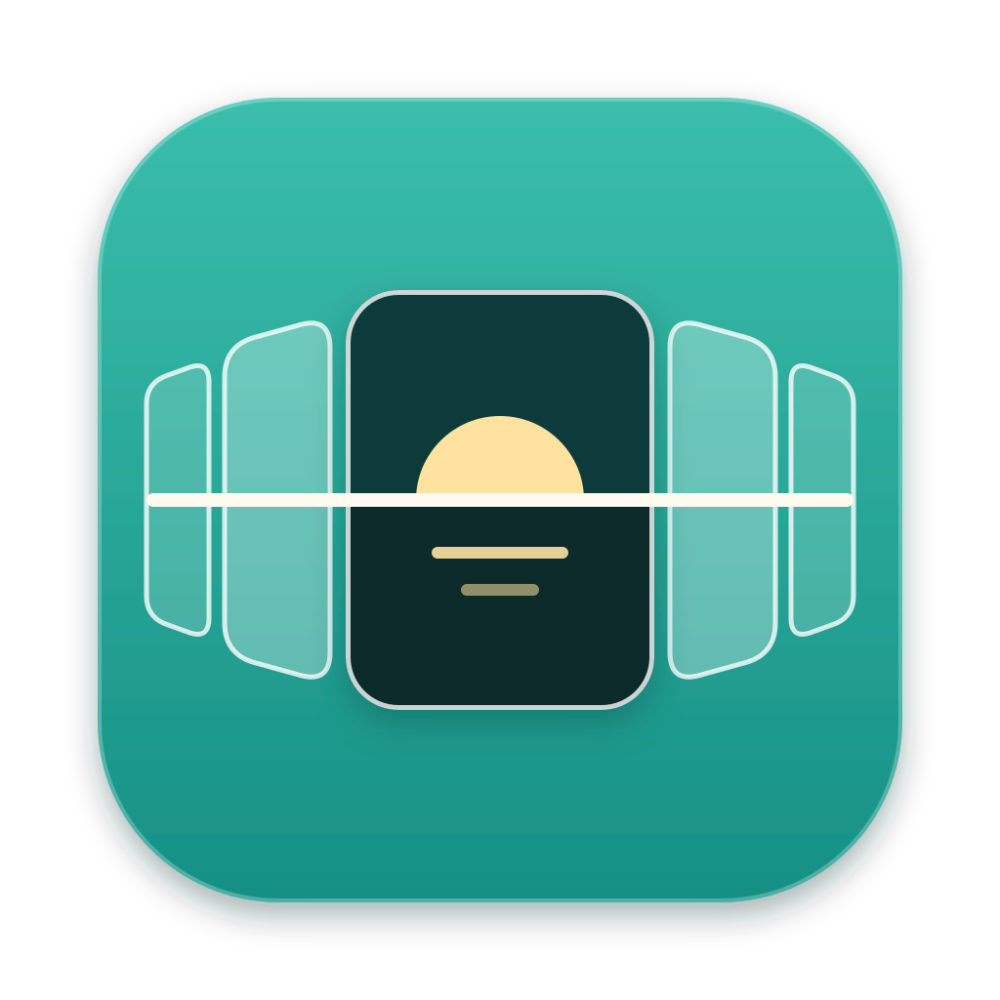
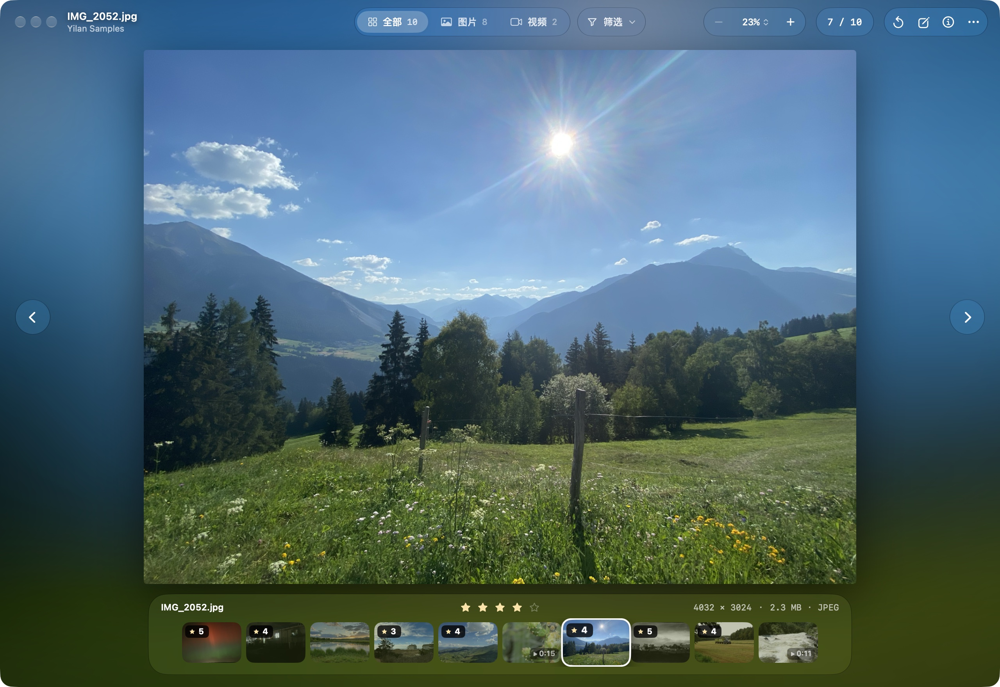
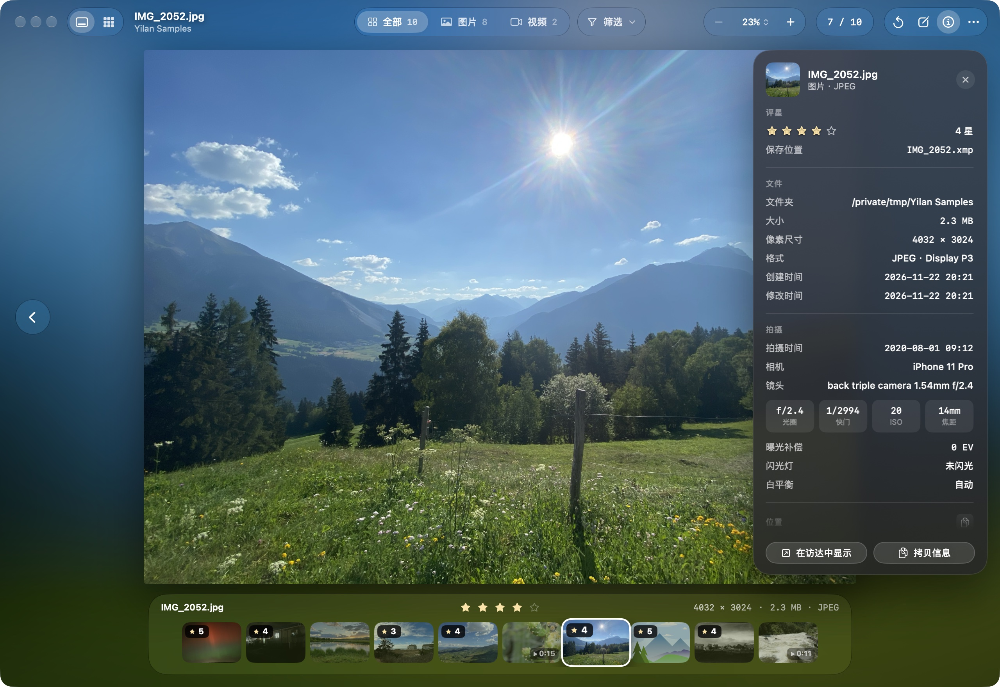
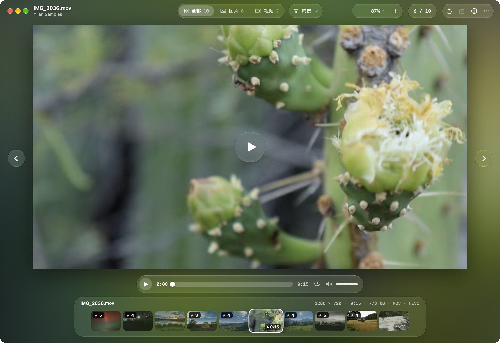

# 一览 Yilan

**简体中文** | [English](README.md)

<p align="center"></p>

**一览（Yilan）** 是一款 macOS 看图和看视频的小工具：打开一张图或一个视频，就能在底部缩略图栏里翻看整个文件夹，方向键秒切，RAW 也能秒开。

## 界面预览

<p align="center"></p>

<table>
  <tr>
    <td></td>
    <td></td>
  </tr>
</table>

## 功能

- 打开一张图或视频，自动列出同文件夹里所有支持的图片和视频，按文件名自然排序
- 顶部切换「全部 / 只看图片 / 只看视频」，显示各类数量
- 底部悬浮缩略图栏，上千个文件也流畅；缩略图在后台生成并缓存
- 预加载前后几张，方向键、滚轮、箭头、点击缩略图都能切换
- 支持 JPEG、PNG、WebP、HEIC/HEIF、GIF（动图）、SVG、TIFF、BMP，以及各品牌相机 RAW（先显示内嵌预览，再后台解码高清版）
- 支持 MP4、M4V、MOV（含 iPhone 的 HEVC 视频）播放，有悬浮控制条
- 缩放、拖动、双击在「适应窗口」和「实际大小」之间切换，旋转
- v0.2 新增：信息面板（按 I，文件信息和 EXIF 拍摄信息）、移到废纸篓并可 ⌘Z 撤销、全屏（按 F）、文件夹变化自动同步（新文件带高亮）、按设计稿分组的快捷键设置页
- 界面语言：简体中文、English

## 系统要求

- macOS 26（Tahoe）或更高版本
- Apple 芯片和 Intel 芯片的 Mac（发布包是通用二进制）

## 下载安装

1. 到 [GitHub Releases](https://github.com/paddychenc75/yilan/releases) 下载最新的 `Yilan-<版本>.zip`，解压后把 `Yilan.app` 拖进「应用程序」文件夹。
2. 这个 App 只做了 ad-hoc 签名，没有 Apple 开发者账号签名，也没有公证，所以第一次打开时 macOS 会提示「无法验证开发者」。有两种解决办法，任选一种：
   - **图形界面：** 先双击打开一次（会被拦下），然后到「系统设置 › 隐私与安全性」，往下找到关于 Yilan 的提示，点「仍要打开」。
   - **命令行：** 在终端执行
     ```sh
     xattr -dr com.apple.quarantine /Applications/Yilan.app
     ```
3. 之后就可以正常打开了。

可以用 `shasum -a 256 Yilan-<版本>.zip` 对照 Release 页面上的校验和。

## 从源码构建

需要 Xcode（支持 macOS 26 SDK）和 [XcodeGen](https://github.com/yonaskolb/XcodeGen)（`brew install xcodegen`）。

```sh
cd app
xcodegen generate
xcodebuild -project Yilan.xcodeproj -scheme Yilan -configuration Release \
  -derivedDataPath build/release build
```

运行测试：

```sh
xcodebuild -project Yilan.xcodeproj -scheme Yilan -destination 'platform=macOS' test
```

打发布包（Release 构建、ad-hoc 签名、打成 zip、输出 SHA-256，结果在 `dist/`）：

```sh
scripts/release.sh
```

## 测试素材和图片来源

- `app/Fixtures/` 里的测试样例全部是 CC0 或公共领域的素材，来源见 [app/Fixtures/CREDITS.md](app/Fixtures/CREDITS.md)。其中的相机 RAW 样张太大，没有放进仓库，下载地址也在这份清单里。

## 许可证

[MIT](LICENSE)，Copyright (c) 2026 PaddyChen。素材各自的许可见上面的来源说明。
